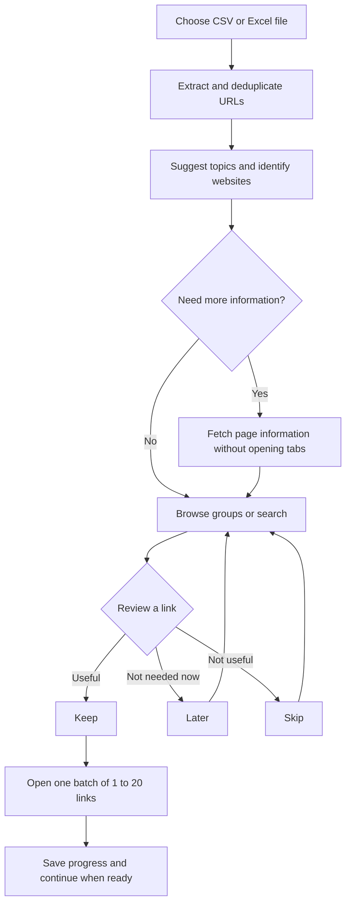
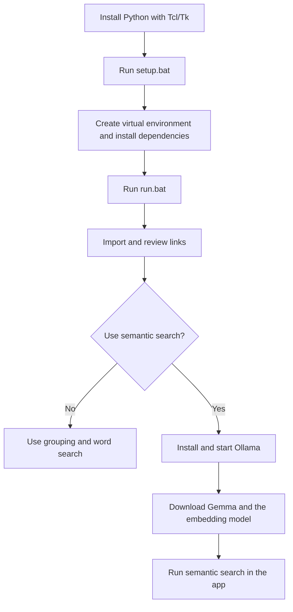
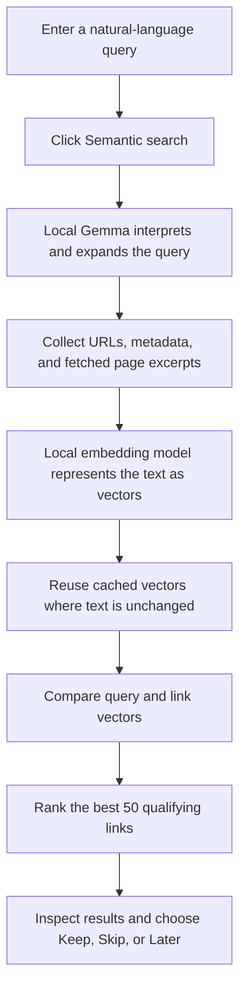
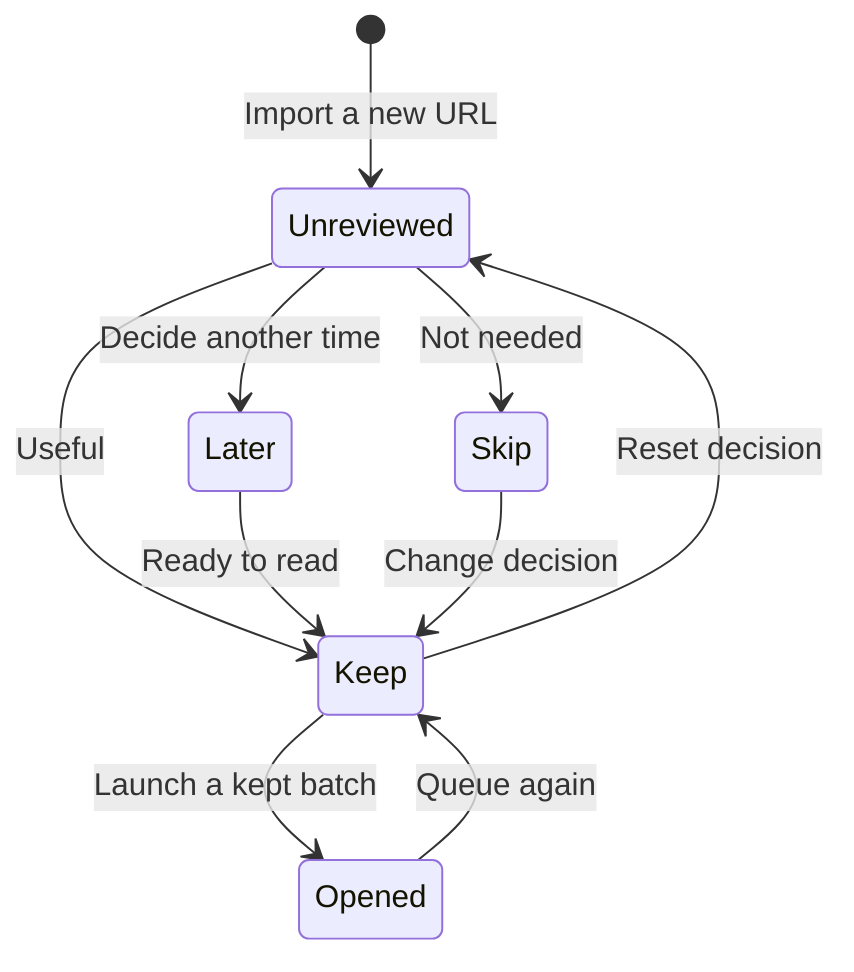
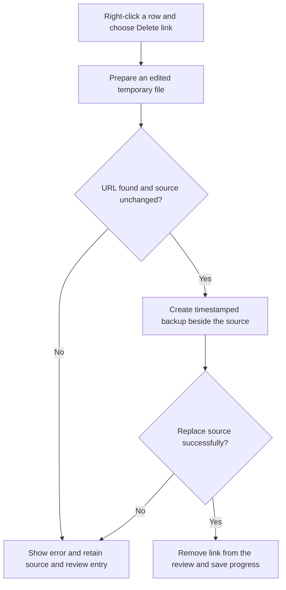
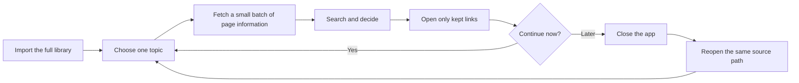
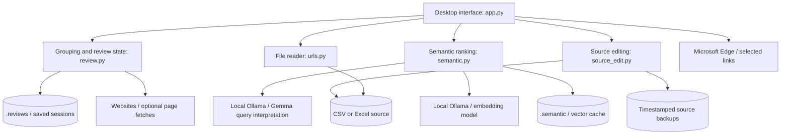

# Smart URL Review

Review, organize, and search links from CSV or Excel files before opening selected pages in Microsoft Edge.

Instead of opening hundreds of tabs at once, build a manageable reading queue: inspect links, group related resources, keep the useful ones, and open one small batch when ready.

## Contents

1. [Overview](#1-overview)
2. [Requirements](#2-requirements)
3. [Installation and startup](#3-installation-and-startup)
4. [Your first review](#4-your-first-review)
5. [Grouping and organization](#5-grouping-and-organization)
6. [Word search](#6-word-search)
7. [Semantic search with local models](#7-semantic-search-with-local-models)
8. [Review decisions and opening links](#8-review-decisions-and-opening-links)
9. [Deleting links and restoring backups](#9-deleting-links-and-restoring-backups)
10. [Saving, resuming, and exporting](#10-saving-resuming-and-exporting)
11. [Example workflows](#11-example-workflows)
12. [Supported files and limitations](#12-supported-files-and-limitations)
13. [Architecture and project structure](#13-architecture-and-project-structure)
14. [Troubleshooting](#14-troubleshooting)
15. [Development and verification](#15-development-and-verification)
16. [Publishing and maintenance](#16-publishing-and-maintenance)

## 1. Overview

The app follows a simple sequence: **Import → Understand → Organize → Decide → Open**.



| Capability | What it does |
| --- | --- |
| File import | Reads URLs from CSV, XLSX, and XLS files |
| Organization | Separates websites and suggests more specific topics |
| Page previews | Retrieves titles, descriptions, and readable page excerpts |
| Word search | Finds matching words in URLs and available metadata |
| Semantic search | Uses local models to find links related to a query's meaning |
| Review decisions | Tracks Keep, Skip, Later, Unreviewed, and Opened |
| Controlled opening | Opens one Edge window with up to 20 kept links per click |
| Right-click actions | Opens one link or deletes it from the review and source file |
| Saved progress | Restores decisions and fetched information for the same source path |
| Export | Creates a CSV report of the remaining links and their decisions |

**No links open automatically when you import or search a file.**

The diagrams in this document use Mermaid. View the README in a Markdown viewer with Mermaid support, such as GitHub, to see them rendered.

## 2. Requirements

| Component | Required for |
| --- | --- |
| Windows | Desktop interface, Edge launching, and legacy Excel automation |
| Python 3.11 or newer, including Tcl/Tk | Running the app |
| Microsoft Edge | Opening reviewed links |
| Python packages in `requirements.txt` | Reading spreadsheets and updating legacy workbooks |
| Ollama running locally | Semantic search only |
| `gemma3:4b` in Ollama | Interpreting semantic-search queries |
| `qwen3-embedding:0.6b` in Ollama | Comparing queries with link content |
| Microsoft Excel installed | Editing legacy `.xls` source files only |
| Internet access | Initial installation, model downloads, fetching websites, and browsing |

Importing files, reviewing decisions, grouping, and word search do not require Ollama. Reading `.xls` files does not require Microsoft Excel; editing them does.

Semantic search runs on local hardware. Speed and memory use depend on the computer and the size of the library. The first query can take longer while models load.

## 3. Installation and startup

### 3.1 Start in this prepared workspace

The current workspace contains a project-local Python installation in `.python` and a virtual environment in `.venv`.

1. Keep both folders in place; `.venv` depends on `.python` here.
2. Double-click `run.bat`.
3. Start Ollama if you plan to use semantic search.
4. Choose a source file in the app.

Run `setup.bat` again if the virtual environment needs to be created or dependencies installed.

### 3.2 Set up on another Windows computer

1. Install [Python](https://www.python.org/downloads/windows/) 3.11 or newer with Tcl/Tk and the Python launcher.
2. Place the project files in a writable folder.
3. Double-click `setup.bat`. It creates `.venv` and installs `requirements.txt`.
4. Double-click `run.bat` to launch the app.
5. For semantic search, install [Ollama](https://ollama.com/download), start it, and download the models:

```powershell
ollama pull gemma3:4b
ollama pull qwen3-embedding:0.6b
ollama list
```

These model downloads are separate from `pip install`. Keep Ollama running after installation. Its local service must be reachable at `http://127.0.0.1:11434`.



### 3.3 Start from a terminal

From the project directory, these commands use the intended environment directly and work without activating a PowerShell script:

```powershell
.\.venv\Scripts\python.exe -m pip install -r requirements.txt
.\.venv\Scripts\python.exe app.py
```

If you prefer activation, use **Command Prompt**:

```bat
.venv\Scripts\activate.bat
python -m pip install -r requirements.txt
python app.py
```

The environment folder is `.venv`. There is no `src` environment to activate.

## 4. Your first review

1. Click **Choose CSV / Excel** and select a supported file. `sample.csv` is included for a quick trial.
2. Check the summary: total remaining links, visible links, and decision counts.
3. Choose a topic or website, or enter a word in the search box.
4. Select a row to see its URL, title or URL-derived hint, description, decision, and preview status.
5. To learn more, select up to 20 links and click **Fetch selected page info (max 20)**.
6. Mark useful links **Keep** and uncertain links **Later**. Use **Skip** for links you do not intend to open.
7. Set **Tabs per window**, then click **Open next kept batch in current filters**.
8. Continue reviewing, or close the app and resume later by choosing the same file.

For a large library, start with one topic and five kept links. Increase the batch size only when useful.

## 5. Grouping and organization

The app provides two independent filters:

- **Topic:** a suggested hierarchy based on website rules, URL terms, and fetched titles or descriptions.
- **Website:** the detected hostname, so links from the same provider can be viewed together.

The **Decision** filter narrows the list by review status.

### 5.1 Examples of automatic topics

| Resource | Example suggested topic |
| --- | --- |
| A programming course | Online courses / Python / Courses |
| A machine-learning specialization | Online courses / Machine learning / Specializations |
| A developer issue | Developer resources / Python / Issues |
| A technical reference | Developer resources / Subject not identified / Documentation |
| A tutorial playlist | Videos / Subject not identified / Playlists |
| An academic publication | Research / Subject not identified / Papers and publications |
| An unfamiliar website | Other websites / example.com |

Subjects can include programming, data science, cloud computing, security, mathematics, business, design, and languages. If the available information does not identify a subject, the app says **Subject not identified**.

Grouping uses rules; it does not ask Gemma to classify every imported page. Fetching page information can improve an automatic topic. Hostnames are grouped as detected; unrelated subdomains are not automatically merged.

### 5.2 Create your own topics

1. Select one or more rows.
2. Enter a topic in **Move selected to topic**, such as `Learning / Web development / Read next`.
3. Click **Apply topic**.
4. Use the Topic filter to find that group again.

Custom topics are saved and are not overwritten by later preview fetching. Existing automatic topics are upgraded when a file is reopened; existing custom topics are retained.

## 6. Word search

Use word search when you know part of a URL, website name, title, or description.

1. Type a word or phrase, such as `Python`, `design tutorial`, or `example.com`.
2. Click **Search** or press **Enter**.
3. Review the matching links.
4. Optionally apply Topic, Website, or Decision filters.

| Behavior | Details |
| --- | --- |
| Search fields | URL, title, description, website, and topic |
| Capitalization | Ignored |
| Multiple words | Every word must appear somewhere in the combined searchable fields; order does not matter |
| Matching | Substring matching; not a whole-word-only search |
| Encoded URLs | URL text is decoded for matching |
| Typing | Immediately updates the current filtered view |
| Search button or Enter | Returns to word search and resets all dropdown filters to All |
| Clear | Removes search text and semantic results; preserves current dropdown filters |

Word search does not inspect the saved page-body excerpts. Use semantic search when you want content-related matches beyond the metadata.

## 7. Semantic search with local models

Use semantic search when you can describe an idea but do not know the exact wording of the link.

### 7.1 Prepare page information

Semantic search can only use information available to the app. An opaque URL alone may reveal very little about its page.

Choose either:

- **Fetch selected page info (max 20):** retrieves information for the selected links.
- **Fetch next 20 unread pages:** retrieves information for the next eligible links across the whole library, independently of the current filters.

Fetching retrieves HTML titles, descriptions, and readable text without opening browser tabs. Wait for the fetch to finish before starting semantic search. Failed pages are skipped by the automatic unread-page action and can be selected and retried manually.

### 7.2 Search by meaning

1. Start Ollama and confirm both required models are installed.
2. Fetch information for the links you want to search meaningfully.
3. Describe what you need, for example `beginner programming lessons`, `research about renewable energy`, or `planning a weekend trip`.
4. Click **Semantic search**. Pressing Enter runs word search instead.
5. Wait for the status message to finish. Results appear in relevance order.
6. Select a result to inspect its similarity score and the available search evidence.
7. Keep the useful links, then open a small batch.



### 7.3 Model responsibilities

| Component | Responsibility |
| --- | --- |
| `gemma3:4b` | Interprets the query and expands related search terms |
| `qwen3-embedding:0.6b` | Produces vectors for comparing the query with link information |
| Application | Caches vectors, compares similarity, filters deleted links, and ranks results |

Gemma receives the query. The embedding model receives the expanded query and link excerpts. Both requests go to the local Ollama service. The app does not require FastEmbed, NumPy, an API key, or a hosted AI endpoint for this workflow.

### 7.4 Reading results and understanding coverage

- The app displays up to **50 results** with cosine similarity **at least 0.30**.
- A similarity score is a ranking signal, not a confidence percentage or a guarantee of relevance.
- A link's score is the strongest match among its indexed excerpts.
- Successful semantic searches reset dropdown filters to **All**; use the filters afterward to narrow the results.
- The status message reports how many links have no fetched page text.
- Editing the query or clicking **Search** returns to word search.
- Fetching more page information invalidates the current semantic results; run the search again afterward.
- Semantic matching can miss useful links or include unrelated ones. More specific queries and better page information help.

The app does not understand screenshots, page images, or PDF contents. It also cannot infer hidden content from pages it cannot retrieve.

## 8. Review decisions and opening links

### 8.1 Decision states

| State | Meaning | Source file changed? |
| --- | --- | --- |
| Unreviewed | No decision yet, or a previous decision was reset | No |
| Keep | Include the link in a future opening batch | No |
| Skip | Leave the link in the library but exclude it from kept batches | No |
| Later | Revisit the link another time | No |
| Opened | The app requested a batch launch for this link | No |

Selecting a decision applies it to every selected row. **Ctrl+A** in the link table selects all visible rows. After a single-link decision, the app advances to another unreviewed link when available.



The diagram shows common transitions. Any remaining link can be reassigned using the decision buttons.

### 8.2 Open one link

Right-click its row and choose **Open this link in Edge**, or select exactly one row and click **Open one selected link to inspect**.

This opens one Edge window containing that link and leaves its decision unchanged. Right-clicking a row selects that row even if several rows were selected previously. Right-clicking empty space does nothing.

### 8.3 Open a batch

1. Mark the desired links **Keep**.
2. Apply any topic, website, decision, or search filters you want.
3. Choose a batch size from **1 to 20**.
4. Click **Open next kept batch in current filters**.
5. Repeat when you are ready for another window.

Only kept links in the current results are eligible. Each click opens one new Edge window, with fewer tabs if fewer eligible links remain. Opened links are marked **Opened** and excluded from subsequent kept batches until you mark them Keep again.

There is no automatic open-all action. Windows use the normal Edge profile; the app does not create separate accounts, profiles, or native Edge tab groups. An Opened status records the launch request, not whether every page loaded successfully.

## 9. Deleting links and restoring backups

**Delete link changes the original CSV or Excel file. Skip and Later do not.**

### 9.1 Delete a link

1. Close the source file in Excel or another editor.
2. Right-click the unwanted row.
3. Choose **Delete link**.
4. Check the status message for the number of changed cells and the backup filename.

The app removes every exact occurrence of that URL from the source, then removes the link from the review, counts, opening batches, and exports. It retains the source rows and columns.



| Source type | Deletion behavior |
| --- | --- |
| CSV | Removes matching URL text while retaining other cell text; encoding and detected delimiter are retained, but quoting may change |
| XLSX | Removes matching URL text and hyperlink targets; display labels remain when separate from the URL |
| XLS | Uses installed Microsoft Excel through `pywin32` to edit the legacy workbook |
| Formula containing the URL | Clears the entire matching formula to avoid leaving an incomplete expression |

For XLSX files, ordinary formatting and unrelated formulas are retained. Advanced Excel objects unsupported by openpyxl may not survive a rewrite; keep the generated backup. Excel automation for XLS files disables macros and external-link updates.

### 9.2 Restore a backup

Backups sit next to the source, with a name such as:

```text
resources.xlsx.<timestamp>.bak
```

To recover file contents:

1. Close the app and the spreadsheet editor.
2. Preserve the current source if you need it.
3. Copy the desired backup to a filename with its normal extension, such as `resources-restored.xlsx`.
4. Open that restored file in the app.

A different source path starts a new review. If you restore a backup over the original path instead, saved review data may still hide previously deleted links; restoring the source alone does not undo those saved review flags. There is no in-app Undo or restore-deleted-links button.

## 10. Saving, resuming, and exporting

### 10.1 Resume a review

Decisions, custom topics, preview information, page excerpts, and deletion flags are saved in `.reviews` after changes.

To resume:

1. Launch the app.
2. Choose the same source file at the same path.
3. Continue reviewing the restored links.

Matching URLs recover their saved information. Newly added URLs start Unreviewed, and URLs removed from the source disappear from the current review. Renaming or moving the source creates a different review identity. Keep `.reviews` if you want to retain your progress.

### 10.2 Export a report

Click **Export review CSV** and choose a destination.

The export includes every non-deleted link, independently of the current filters, with these columns:

```text
url, site, category, status, title, description, preview
```

Page-body excerpts are not included. Text beginning with spreadsheet formula characters is prefixed with an apostrophe to keep it as text.

The export is a report, not a session backup. Importing it as a source reads its URLs but does not restore decisions from its status column. The `.reviews` folder holds resumable review state.

### 10.3 Where information goes

| Action | Reads or writes |
| --- | --- |
| Import | Reads the selected source file |
| Decisions, topics, previews | Writes local review data under `.reviews` |
| Fetch page information | Contacts the selected websites and saves returned text locally |
| Semantic search | Sends queries and excerpts to local Ollama and caches vectors under `.semantic` |
| Open links | Launches Edge; Edge then contacts those websites |
| Delete link | Rewrites the source and creates a backup beside it |
| Export | Writes a report to the selected destination |

No online AI account is required. Review files and caches contain URLs and potentially page text, so consider their contents before sharing the project folder. Generated environments and caches are excluded by `.gitignore`.

## 11. Example workflows

### Workflow A: Build a learning queue

1. Import a spreadsheet of learning resources.
2. Choose a specific course topic and a provider website.
3. Fetch information for a small selection.
4. Mark useful lessons Keep and the rest Skip or Later.
5. Open five kept links and continue after reviewing them.

### Workflow B: Find resources by an idea

1. Import the library and fetch page information in groups of 20.
2. Start Ollama.
3. Search semantically for `beginner-friendly explanations of renewable energy`.
4. Inspect the ranked results and select the useful resources.
5. Apply a custom topic such as `Research / Energy / Read next`.
6. Mark the selected links Keep and open one batch.

### Workflow C: Clean up an old collection

1. Use word search to find links from a particular website.
2. Right-click a link to inspect it individually.
3. Use Skip if you want to retain it without opening it in batches.
4. Use Delete link if you also want it removed from the source.
5. Keep the automatic backups until you are satisfied with the cleanup.
6. Export a report of the remaining library.

### Workflow D: Review a large library over several sessions



For example, a library with 2,000 links does not require 100 Edge windows. Review one subject, keep a handful of relevant pages, open those pages, and leave the rest for another session.

## 12. Supported files and limitations

### 12.1 Import behavior

| Item | Support |
| --- | --- |
| CSV | UTF-8, UTF-8 with BOM, and Windows-1252; common delimiters are detected |
| XLSX | All worksheets and columns, including hidden sheets |
| XLS | All worksheets and columns through `xlrd` |
| Link formats | `http://`, `https://`, and `www.` addresses |
| Multiple links per cell | Supported |
| Spreadsheet hyperlinks | Targets are read where supported by the reader |
| Duplicate URLs | Exact duplicates are removed in first-seen order |
| Bare domains | Add `https://` or `www.` first |
| Excel formulas | Scanned as text, not calculated; dynamically assembled URLs may be missed |

Trailing sentence punctuation is trimmed during URL extraction. URLs are not normalized by removing tracking parameters, resolving redirects, or merging similar pages.

### 12.2 Page-fetching limits

- Only HTML and XHTML are processed.
- Each fetch reads at most 512 KiB and has a 10-second request timeout.
- Up to 12,000 characters of readable text are saved per page.
- Semantic indexing uses up to 5,400 characters of page text in chunks, plus bounded metadata and the URL.
- Scripts, styles, and noscript content are excluded from the extracted text.
- The fetcher does not run JavaScript, use browser login cookies, render PDFs, or interpret images.
- Sites may reject requests, redirect them, or require authentication.

Page titles and descriptions come from the websites. They are not AI-generated summaries, and a failed preview does not change the review decision.

## 13. Architecture and project structure



```text
url_history_open/
|-- app.py                  Desktop interface and Edge actions
|-- urls.py                 URL extraction and source-file reading
|-- review.py               Topic rules, page fetching, and saved reviews
|-- semantic.py             Local Ollama queries, embeddings, and ranking
|-- source_edit.py          Source deletion, backups, and file replacement
|-- requirements.txt        Python dependencies
|-- setup.bat               Environment and dependency setup
|-- run.bat                 Launch using the project environment
|-- sample.csv              Example input
|-- tests/                  Unit and integration checks
|-- .python/                Project-local Python in this workspace
|-- .venv/                  Virtual environment
|-- .reviews/               Saved review state, created as needed
|-- .semantic/              Vector cache, created as needed
|-- .tools/                 Local installation artifacts, if present
`-- README.md               This guide
```

Legacy model files under `.semantic/models` may exist from an earlier search backend. They are not used by the current Ollama implementation. Ollama manages the current model files separately.

## 14. Troubleshooting

| Problem | What to check |
| --- | --- |
| App does not start | Run `setup.bat`, then launch with `run.bat` so the intended Python environment is used |
| Python launcher returns Access is denied | Use the working project-local `.python` installation, or repair/install Python and rerun setup |
| PowerShell blocks activation | Use `run.bat`, the explicit `.venv` Python command, or Command Prompt activation |
| Missing spreadsheet package | Run `.\.venv\Scripts\python.exe -m pip install -r requirements.txt` |
| An error mentions FastEmbed | Close any older app instance and restart this version with `run.bat`; current semantic search does not import FastEmbed |
| Cannot connect to Ollama | Start Ollama and confirm the service is listening at `127.0.0.1:11434` |
| Ollama reports a missing model | Run `ollama list`, then pull the missing model from the installation section |
| Semantic search is slow | Allow model loading to finish; reduce the library or fetch/search one manageable collection at a time |
| Search returns few relevant links | Fetch page information, wait for it to finish, rerun semantic search, and make the query more specific |
| A website preview fails | It may require login, block requests, or not be HTML; inspect it individually in Edge |
| No kept links can be opened | Mark links Keep and check the current search and dropdown filters |
| Previously opened links do not reopen in a batch | Mark them Keep again, or use the individual-open action |
| Delete fails | Close Excel, check source-folder write access, and reload if the source changed |
| XLS deletion fails | Install Microsoft Excel and the requirements, or save the workbook as XLSX |
| A restored link stays hidden | Saved review deletion flags may remain for the original source path; see the backup-restoration workflow |
| Moving a file loses apparent progress | Reviews are associated with the source's absolute path; reopen the original path to recover that session |

## 15. Development and verification

Run commands from the project directory using the virtual environment.

### Unit tests

```powershell
.\.venv\Scripts\python.exe -m unittest discover -s tests -v
```

These cover file reading, URL extraction, grouping, saved state, source edits and backups, semantic ranking/cache behavior, and mocked local-model calls.

### Desktop integration tests

```powershell
.\.venv\Scripts\python.exe -m unittest discover -s tests -p ui_check.py -v
```

These require access to the Windows desktop/Tcl runtime. Edge launches are mocked. They cover search, ranking display, right-click actions, deletion, and filtered batch opening.

### Legacy Excel integration test

```powershell
.\.venv\Scripts\python.exe -m unittest discover -s tests -p excel_check.py -v
```

Requires installed Microsoft Excel. It creates a temporary workbook and verifies deletion and backup behavior.

### Real local-model integration test

```powershell
.\.venv\Scripts\python.exe -m unittest discover -s tests -p semantic_check.py -v
```

Requires Ollama running with both models installed. It uses synthetic text to check actual model-based relevance ranking; it does not read your source library.

### Dependency check and manual launch

```powershell
.\.venv\Scripts\python.exe -m pip check
.\.venv\Scripts\python.exe app.py
```

## 16. Publishing and maintenance

See [PUBLISHING.md](PUBLISHING.md) for the complete staging, checking, committing, publishing, and maintenance workflow. See [SECURITY.md](SECURITY.md) for private-data exclusions, secret scanning, and exposure response.

The included GitHub Actions workflow runs Windows unit and desktop checks on Python 3.11 and 3.13, code linting, tracked-file checks, secret scanning, dependency consistency checks, and a vulnerability audit. Dependabot checks dependency and action updates weekly. Live Ollama and Microsoft Excel integration checks remain local/manual.

Install development tools and enable the local commit hook on each clone:

```powershell
.\.venv\Scripts\python.exe -m pip install -r requirements-dev.txt
git config core.hooksPath .githooks
```

Real spreadsheets, exported reports, review state, caches, environments, backups, and credential files stay local. Only the synthetic `sample.csv` is intentionally tracked. GitHub branch protection and native security features must be verified separately in repository settings.
